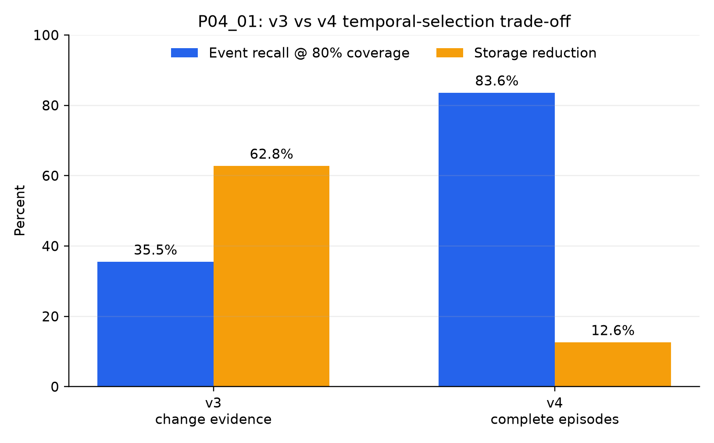
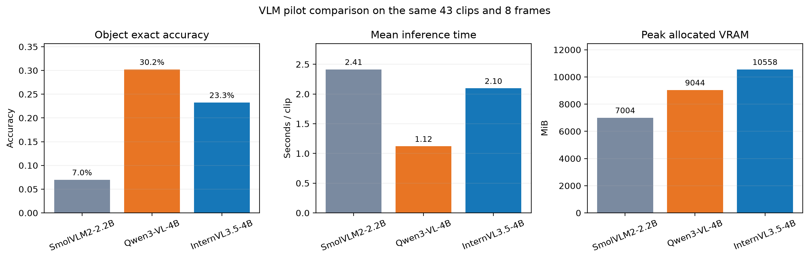

# EventADL Evidence

Research prototype for detecting and labeling hand–object interaction episodes in long egocentric Activities of Daily Living (ADL) videos.

> This repository covers the offline detector, episode generation, VLM labeling, and evaluation pipeline only. It does not contain a web service, user account integration, authentication code, private video, or a clinical product.

## Research question

Can event based selection preserve meaningful hand activity while reducing the amount of video that must be stored and reviewed?

```text
Untrimmed egocentric video
  -> motion and 100DOH hand–object interaction signals
  -> temporal smoothing and variable length episodes
  -> 3 FPS adaptive VLM input
  -> structured action candidates
  -> second pass visual verification
  -> temporal, storage, detector, and VLM evaluation
```
## Workflow


This repo includes only the validated offline pipeline. 
The Web UI and query LLM components are implemented locally but remains under review and the therefore not included.


## Implemented components

- EPIC-KITCHENS annotation analysis and timestamp validation
- Full, Periodic, Motion, Hand, Object, and interaction baselines
- 100DOH hand box, contact state, and contacted target object integration
- change triggered evidence clips and complete interaction episodes
- adaptive 3 FPS frame sampling with safe chunking for long episodes
- SmolVLM2, Qwen3-VL, and InternVL comparison
- second pass VLM verification with `verified`, `rejected`, and `uncertain` outcomes
- event recall, GT coverage, storage reduction, latency, VRAM, and JSON validity evaluation

## Pilot results

The development pilot used the 19.25 minute EPIC-KITCHENS `P04_01` video with 262 annotated action intervals. These are single-video development results, not a held-out or clinical benchmark.

| Method | Recall at 80% GT coverage | Mean GT coverage | Storage reduction |
| --- | ---: | ---: | ---: |
| v3 change evidence | 35.50% | 43.41% | 62.76% |
| v4 complete interaction episode | 83.59% | 85.97% | 12.60% |



On the same 43 v3 evidence clips, Qwen3-VL-4B produced valid JSON for all clips, averaged 1.12 seconds per clip, and used approximately 8.8 GiB peak allocated VRAM. Exact ADL scores remain low because clips can overlap multiple actions while this pilot used one primary ground-truth string.



## Known failure and verifier

Manual review found a false cutting description in an episode that showed bag squeezing and kneading. The two-pass verifier reviewed 33 targeted action candidates: 18 passed and 15 were rejected. The false cutting candidate disappeared. A brief true slice remained missed because verification cannot recover an action that the first pass never proposes.

This result supports a precise interpretation:

- verification can improve precision;
- candidate generation still determines recall;
- every automated label requires evidence review before clinical use.

## Environment

Validated main environment:

- Python 3.11
- NVIDIA RTX 3090 24GB
- PyTorch 2.14.1 + CUDA 13.0
- Transformers 5.23.0

```bash
conda env create -n adl-event-logger -f environment.yml
conda activate adl-event-logger
python -m pip install -e .
python scripts/check_system.py
```

100DOH uses a separate legacy Python 3.8 environment. Its external repository, checkpoint, dataset videos, and weights are not redistributed here.

## Reproduction

Run the detector and complete-episode pipeline:

```bash
bash scripts/run_adl_episode_v4.sh /absolute/path/to/video.mp4
```

For the staged P04_01 experiments, follow [docs/runbook.md](docs/runbook.md). Detailed module responsibilities are in [docs/IMPLEMENTATION_GUIDE.md](docs/IMPLEMENTATION_GUIDE.md).

## Documentation

- [Research plan](docs/RESEARCH_PLAN.md)
- [Implementation guide](docs/IMPLEMENTATION_GUIDE.md)
- [Final offline pipeline report](docs/FINAL_PROJECT_REPORT.md)
- [Command runbook](docs/runbook.md)
- [Environment setup](docs/setup_log.md)

## Repository safety and data policy

The repository intentionally excludes:

- original and private videos;
- extracted frames and generated clips;
- model checkpoints and caches;
- tokens, API keys, `.env` files, and authentication material;
- web clients, servers, upload endpoints, and account integration;
- local absolute paths and internal execution logs.

Download datasets and models separately under their respective licenses. This prototype is not a diagnostic device.
