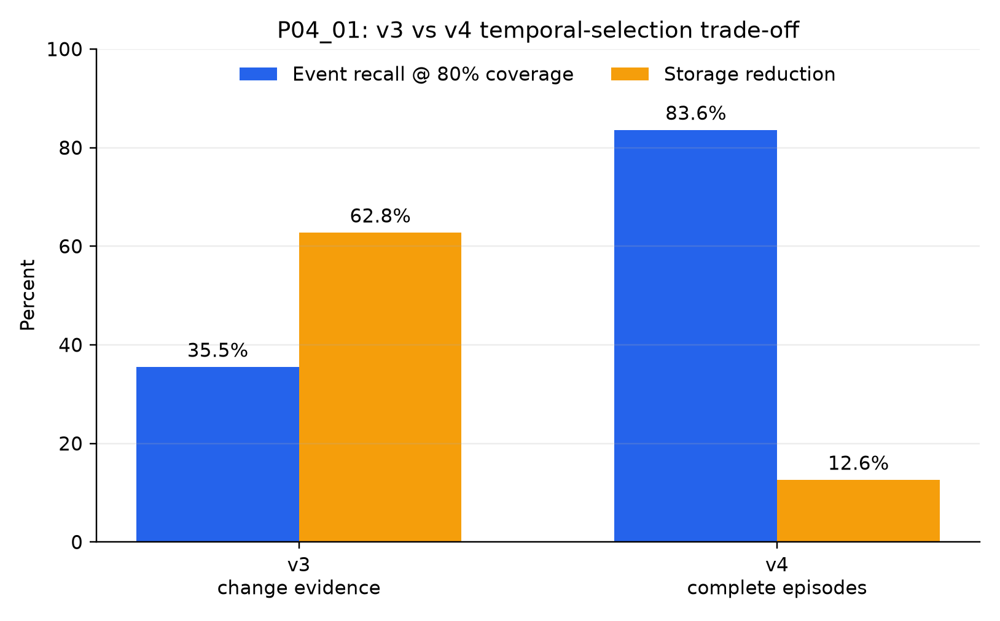
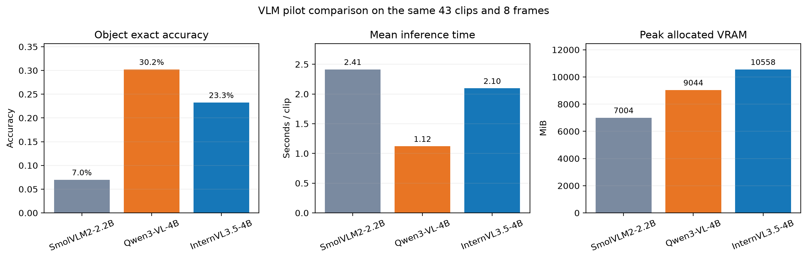

# Final Implementation Report: Offline Event-Based ADL Pipeline

## 1. Implemented system

The project implements an offline pipeline that detects 100DOH hand-object interactions in continuous egocentric video, creates variable-length episodes, produces structured action JSON with local VLMs, and evaluates temporal coverage, storage, speed, memory use, and label quality.

## 2. How the implementation evolved

- **v0:** MediaPipe hands, Faster R-CNN objects, and a distance heuristic established the end-to-end data flow.
- **v1:** the learned 100DOH interaction detector was installed in a separate legacy environment.
- **v2/v3:** lifecycle, object-change, contact-state-change, and motion triggers produced short evidence clips around changes.
- **v4:** complete interaction episodes were saved from start to end, with adaptive 3 FPS VLM input.
- **Verifier:** after observing a false cutting description, a second visual pass was added for each action candidate.

## 3. Temporal-selection results

| Method | Recall at 80% GT coverage | Mean GT coverage | Storage reduction |
| --- | ---: | ---: | ---: |
| v3 change evidence | 35.50% | 43.41% | 62.76% |
| v4 complete interaction episode | 83.59% | 85.97% | 12.60% |

v3 reduced storage more aggressively but lost much of each action. v4 preserved actions far better, but storage reduction was modest on the action-dense kitchen pilot.

## 4. VLM comparison

On the same 43 v3 evidence clips, Qwen3-VL-4B produced valid JSON for every clip, averaged 1.12 seconds per clip, and used approximately 8.8 GiB peak allocated VRAM. Under this pilot protocol it offered a better accuracy/speed balance than SmolVLM2 and InternVL.

Exact label scores were low for two reasons. A clip could overlap several GT actions while evaluation selected one primary GT string, and semantically similar VLM wording could differ from the EPIC taxonomy and be counted as incorrect.

## 5. Verifier regression test

The verifier examined 33 candidates from two problem episodes: 18 were verified and 15 were rejected. The false cutting candidate disappeared. A brief true slice remained missed because the first-pass candidate generator never proposed it.

Therefore, verification can reduce false positives, but it does not solve candidate recall.

## 6. Conclusion

There was no single best temporal method. Change-based evidence clips are useful when storage efficiency is the priority; complete interaction episodes are better when preserving full action context is the priority. VLM output benefits from a verification stage, but verification alone cannot recover missing candidates.

## 7. Limitations

- The main numbers come from one development video, not a held-out multi-participant benchmark.
- `P04_01` is action-dense and does not represent a full hour of home life with long inactive periods.
- The detector audit is small.
- Exact-string action evaluation underestimates semantic matches and mishandles multi-action clips.
- Kitchen activity is not equivalent to stroke rehabilitation assessment.
- The system is not a diagnostic or clinical device.

## 8. Recommended next experiments

1. Record a consented one-hour GoPro home video containing both activity and inactivity.
2. Test held-out EPIC participants and report confidence intervals.
3. Add multi-label and synonym-aware VLM evaluation.
4. Improve first-pass candidate recall with denser temporal proposals.
5. Compare complete episodes with event-centered evidence views for human review.
6. Evaluate hand laterality and bimanual-use queries only after creating task-specific ground truth.
